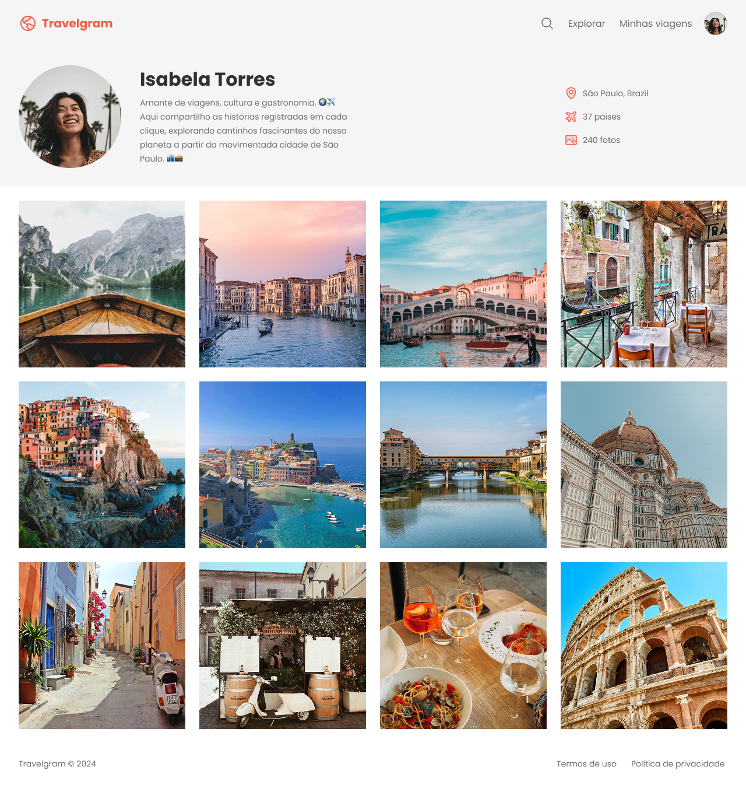

# Travelgram | Perfil de Viagens

-8257e5?style=for-the-badge)


> **🎓 Projeto guiado:** desenvolvido acompanhando as aulas da **formação Full Stack da [Rocketseat](https://www.rocketseat.com.br/)**. O layout e a proposta são do curso; a implementação foi feita por mim, seguindo o professor.

Página de perfil de um viajante, com biografia, estatísticas de viagens e galeria de fotos. Construída com HTML5 e CSS3, explorando semântica, Flexbox, responsividade mobile-first, acessibilidade e SEO.

🔗 **[Ver projeto online](https://lpwesley.github.io/perfil-de-viagens/)**

## 📸 Prévia



## 🛠️ Tecnologias

- **HTML5:** estrutura semântica
- **CSS3:** Flexbox, variáveis CSS e Media Queries
- **Git e GitHub:** commits, branches e Pull Requests
- **GitHub Pages:** publicação

## ⚙️ Funcionalidades

- Cabeçalho com navegação e identidade visual
- Perfil com foto, biografia e estatísticas de viagens
- Galeria de fotos com layout responsivo
- Interface adaptada para dispositivos móveis
- Melhorias de acessibilidade e SEO

## 📚 O que pratiquei

**HTML, acessibilidade e SEO**
- Elementos semânticos e hierarquia de títulos
- Idioma da página com `lang` e textos alternativos com `alt`
- Metadados para mecanismos de busca

**CSS e Flexbox**
- `display: flex`, `align-items`, `justify-content` e `gap`
- Variáveis CSS com `:root` para cores e tipografia
- Organização e reutilização de estilos

**Responsividade**
- Abordagem mobile-first com Media Queries
- Adaptação do perfil e da galeria a diferentes telas
- Dimensionamento e posicionamento de imagens

**Git e GitHub**
- Branches para novas funcionalidades e integração via Pull Requests
- Deploy com GitHub Pages

## 📂 Estrutura

```text
perfil-de-viagens/
├── css/
├── img/
│   └── preview-travelgram.png
├── index.html
└── README.md
```

## 💻 Como executar

Não há dependências. Basta clonar e abrir no navegador:

```bash
git clone https://github.com/lpwesley/perfil-de-viagens.git
cd perfil-de-viagens
```

Abra o `index.html` no navegador ou use a extensão **Live Server** no VS Code.

## 🎓 Créditos

Projeto proposto pela **[Rocketseat](https://www.rocketseat.com.br/)** como parte da formação Full Stack. O design e o conteúdo base pertencem ao curso.

---

Desenvolvido por **Wesley Lauwer** · [GitHub](https://github.com/lpwesley)
